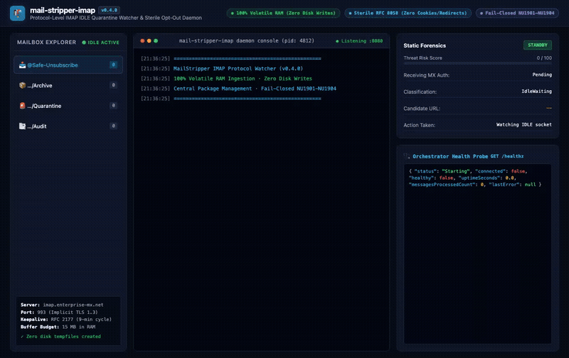

# mail-stripper-imap 📬⚙️

> Protocol-Level **IMAP IDLE Quarantine Watcher**, Automated Folder Segregator & Sterile Opt-Out Daemon.

Built on Jeffrey Stedfast's industry-standard [`MailKit`](https://github.com/jstedfast/MailKit) library.  
Companion daemon to [`knowthankyew/mail-stripper`](https://github.com/knowthankyew/mail-stripper).

---

## 📺 Interactive Demonstration

Watch the complete automated IMAP IDLE quarantine watcher workflow in action—from real-time mailbox push notifications and volatile RAM ingestion to threat quarantine, sterile opt-out execution, and cryptographic audit reporting:



> 📹 **High-Definition Recording**: [`demo.mp4`](demo.mp4) *(Playwright automated run, 1366x860)*  
> 🔄 **Automated Reproduction**: To re-record this demonstration at any time, run: `./scripts/record-demo.sh`

---

## 🎯 The Real-World Problem: Why "Unsubscribe" Is Dangerous

Modern email users and corporate inboxes receive an overwhelming volume of automated newsletters, cold sales sequences, and deceptive phishing lures. When attempting to unsubscribe through traditional means, users face critical security and privacy hazards:

1. **Active Reconnaissance Traps & Victim Confirmation**:  
   Malicious senders deliberately embed unauthenticated tracking beacons and deceptive unsubscribe links. When a user clicks these links or a naive script triggers them, the attacker receives confirmation that the email address is actively monitored by a human target. This instantly escalates the victim's threat profile, resulting in intensified phishing campaigns and credential harvesting.

2. **Ambient Cookie Leaks & Session Exposure**:  
   Standard web browsers and generic HTTP libraries automatically transmit ambient authentication cookies, follow cross-origin redirects, and execute remote JavaScript. A deceptive opt-out link can exploit open redirects to harvest session identifiers, leak corporate IP addresses, or trigger tracking pixels.

3. **Manual Overhead & Spam Filter Inefficiency**:  
   Marking messages as spam does not revoke marketing lists or unsubscribe users; it merely pollutes local filter heuristics. Manually visiting dozens of unverified unsubscribe pages each week consumes hours and continually exposes users to malicious web content.

---

## 🛡️ The Real-World Solution: Autonomous Protocol-Level Guardian

`mail-stripper-imap` provides an autonomous, headless protocol-level solution:

```
┌─────────────────┐       IMAP IDLE Push       ┌────────────────────────┐
│  Remote Mailbox │ ─────────────────────────> │   mail-stripper-imap   │
│ (e.g. Fastmail, │                            │ (Headless .NET Daemon) │
│  Gmail, Proton) │ <───────────────────────── │                        │
└─────────────────┘      Keyword Tagging &     └───────────┬────────────┘
                         Folder Segregation                │
                                                           │ Volatile RAM Stream
                                                           │ (Zero Disk Writes)
                                                           ▼
                                               ┌────────────────────────┐
                                               │   Local mailStripper   │
                                               │   Forensic Analyzer    │
                                               │  (http://localhost:5001)
                                               └────────────────────────┘
```

1. **Zero-Effort Operator Workflow**:  
   Users simply drag unwanted emails into a dedicated mailbox folder (`@Safe-Unsubscribe`), or configure a server-side mail rule to route suspect messages automatically.
2. **Instant Push Detection via IMAP IDLE (`RFC 2177`)**:  
   The daemon maintains an efficient, persistent TLS connection with upstream IMAP servers. Message arrivals trigger real-time push notifications without polling overhead, backed by exponential backoff reconnection recovery.
3. **Automated Provisioning**:  
   On startup, the daemon checks for and provisions the complete folder hierarchy across IMAP directory separators:
   - `@Safe-Unsubscribe` *(Monitored Ingestion Queue)*
   - `@Safe-Unsubscribe/Archive` *(Successfully processed safe opt-outs)*
   - `@Safe-Unsubscribe/Quarantine` *(Isolated phishing lures and tracking traps)*
   - `@Safe-Unsubscribe/Audit` *(In-mailbox cryptographic forensic audit reports)*
4. **Threat Quarantine vs. Sterile Opt-Out**:  
   - **Poison Traps**: Messages classified with poison signals or unaligned provenance are immediately tagged with the `$SuspiciousTrap` IMAP keyword and moved to `@Safe-Unsubscribe/Quarantine`. Automated execution is strictly refused.
   - **Legitimate Newsletters**: Messages verified as qualifying RFC 8058 One-Click POST candidates can be automatically unsubscribed via isolated sterile HTTP POST requests (`AutoExecuteSterileUnsubscribe: true`), tagged with `$SafeUnsubscribed`, and moved to `@Safe-Unsubscribe/Archive`.
5. **In-Mailbox Forensic Audit Reports**:  
   For every processed message, a defanged RFC 822 MIME summary message is generated into `@Safe-Unsubscribe/Audit` (tagged with `$AuditLogged`). Reports include defanged links (`hxxps://`), receiving MX alignment verdicts, SHA-256 digests of the original email, and exact HTTP response metrics.

---

## 🏛️ Portfolio Architectural Invariants

Within the `@knowthankyew` open-source privacy portfolio, `mail-stripper-imap` operates under non-negotiable architectural boundaries:

### The Air-Gap Boundary: Companion A vs. Companion B
- **Companion A ([`mailStripper`](https://github.com/knowthankyew/mail-stripper))**:  
  An air-gapped forensic parser and interactive web viewer. Enforces strict Content Security Policy (`connect-src 'self' http://localhost:8000;`) with **zero outbound internet access**. It analyzes raw RFC 822 bytes locally but never initiates external network requests.
- **Companion B ([`mail-stripper-imap`](https://github.com/knowthankyew/mail-stripper-imap))**:  
  The active network protocol client. It connects upstream over TLS to remote IMAP servers and issues outbound opt-outs under strict sterile constraints.

### Core Non-Negotiable Invariants

| Invariant | Implementation | Architectural Guarantee |
|:---|:---|:---|
| **1. 100% Volatile RAM Ingestion** | `System.IO.MemoryStream` | All email parsing, streaming, and forensic relay occurs entirely in transient memory. Zero bytes are ever written to `/tmp` or persistent disk. |
| **2. Sterile RFC 8058 Execution** | `SocketsHttpHandler` | Opt-out HTTP POST requests strictly enforce `UseCookies = false`, `AllowAutoRedirect = false`, drop response streams immediately upon header receipt, require `https://`, and reject poison lures. |
| **3. Central Package Management (CPM)** | `Directory.Packages.props` | All NuGet package versions are centrally managed. Patched dependencies (e.g. `System.Security.Cryptography.Pkcs >= 10.0.13`) prevent supply-chain vulnerabilities. |
| **4. Fail-Closed Security Audits** | `Directory.Build.props` | MSBuild treats package vulnerability warnings (`NU1901-NU1904`) as fatal compilation errors. |
| **5. Heap Memory Safety** | `MaxMessageByteSize = 15 MB` | Bounded message size budget prevents memory exhaustion or denial-of-service during high-volume mailbox sweeps. |
| **6. Unprivileged Sandboxed Execution** | `USER $APP_UID` & systemd | Docker images run under non-root user (UID 1654); systemd units enforce strict kernel sandboxing (`ProtectSystem=strict`, `NoNewPrivileges=true`, `PrivateTmp=true`). |
| **7. Claims & Number Parity** | `scripts/audit-claims.mjs` | Dynamic linter executes `dotnet test` and verifies that all documented numbers match reality. |

---

## 🚀 Quickstart

Clone the repository and run:

```bash
./start.sh
```

`start.sh` builds the daemon, verifies central package management, runs the automated test suite, and launches the daemon in test configuration.

*(Prerequisite: [.NET 10 SDK](https://dotnet.microsoft.com/download) installed).*

---

## 🐳 Container Deployment

### Multi-Stage Docker Build

A hardened multi-stage Dockerfile is provided, publishing a minimal Alpine container executed under unprivileged non-root credentials (`USER $APP_UID`):

```bash
# Build container image
docker build -t mail-stripper-imap:latest .

# Run container with environment configuration
docker run -d \
  --name mail-stripper-imap \
  -p 127.0.0.1:8080:8080 \
  -e IMAP__HOST=imap.example.com \
  -e IMAP__PORT=993 \
  -e IMAP__USE_SSL=true \
  -e IMAP__USERNAME=user@example.com \
  -e IMAP__PASSWORD=secret \
  -e IMAP__MAIL_STRIPPER_URL=http://host.docker.internal:5001 \
  mail-stripper-imap:latest
```

### Docker Compose Orchestration

Run both `mail-stripper` (the forensic analyzer) and `mail-stripper-imap` (the protocol watcher) together:

```bash
docker compose up -d
```

The composition exposes port `5001` on loopback for the analyzer engine and port `8080` for watcher health probes.

---

## 🐧 Linux Systemd Service

For bare-metal Linux servers and VMs, a hardened systemd unit file is provided at [`systemd/mail-stripper-imap.service`](systemd/mail-stripper-imap.service):

```bash
# 1. Install published binaries
sudo mkdir -p /opt/mail-stripper-imap
sudo cp -r /path/to/publish/* /opt/mail-stripper-imap/

# 2. Provision service user
sudo useradd -r -s /usr/sbin/nologin -d /opt/mail-stripper-imap mailstripper
sudo chown -R mailstripper:mailstripper /opt/mail-stripper-imap

# 3. Configure environment file
sudo mkdir -p /etc/mail-stripper-imap
sudo install -m 600 -o mailstripper -g mailstripper systemd/mail-stripper-imap.env.example /etc/mail-stripper-imap/env
# (Edit /etc/mail-stripper-imap/env with your IMAP credentials)

# 4. Install and enable systemd service
sudo cp systemd/mail-stripper-imap.service /etc/systemd/system/
sudo systemctl daemon-reload
sudo systemctl enable --now mail-stripper-imap
sudo systemctl status mail-stripper-imap
```

---

## 🩺 Health Monitoring & Orchestrator Probes

The daemon provides an embedded HTTP health server (default loopback `127.0.0.1:8080`):

| Endpoint | Probe Type | Description | Healthy Response |
|:---------|:-----------|:------------|:-----------------|
| `/healthz` | Readiness / Health | Returns `200 OK` when connected to IMAP and active; returns `503 Service Unavailable` during reconnect/failure. | `{"status":"Healthy","connected":true,...}` |
| `/readyz` | Readiness | Alias for `/healthz` for Kubernetes readiness probes. | `200 OK` / `503 Unavailable` |
| `/livez` | Liveness | Returns `200 OK` as long as the process is alive. | `{"status":"Alive"}` |

### Sample Health Payload (`/healthz`)

```json
{
  "status": "Healthy",
  "connected": true,
  "healthy": true,
  "startedUtc": "2026-11-10T14:30:00+00:00",
  "uptimeSeconds": 1824.5,
  "lastConnectedUtc": "2026-11-10T14:30:02+00:00",
  "lastDisconnectedUtc": null,
  "lastMessageProcessedUtc": "2026-11-10T14:45:12+00:00",
  "messagesProcessedCount": 14,
  "lastError": null
}
```

---

## ⚙️ Configuration Reference

Configuration can be specified in `appsettings.json`, via standard hierarchical environment variables (`IMAP__*`), or flat environment variables (`IMAP_*`):

| Variable | Property | Default | Description |
|:---------|:---------|:--------|:------------|
| `IMAP__HOST` / `IMAP_HOST` | `Host` | `127.0.0.1` | Remote IMAP server hostname or IP |
| `IMAP__PORT` / `IMAP_PORT` | `Port` | `993` | IMAP port (993 for SSL/TLS, 143 for STARTTLS) |
| `IMAP__USE_SSL` / `IMAP_USE_SSL` | `UseSsl` | `true` | Enables implicit TLS/SSL connection |
| `IMAP__USERNAME` / `IMAP_USERNAME` | `Username` | `""` | IMAP account username / email address |
| `IMAP__PASSWORD` / `IMAP_PASSWORD` | `Password` | `""` | IMAP account password or app-specific token |
| `IMAP__MONITORED_FOLDER` | `MonitoredFolder` | `@Safe-Unsubscribe` | Mailbox folder to monitor via IDLE |
| `IMAP__ARCHIVE_FOLDER` | `ArchiveFolder` | `@Safe-Unsubscribe/Archive` | Target folder for successfully processed opt-outs |
| `IMAP__QUARANTINE_FOLDER` | `QuarantineFolder` | `@Safe-Unsubscribe/Quarantine` | Target folder for malicious / deceptive lures |
| `IMAP__AUDIT_FOLDER` | `AuditFolder` | `@Safe-Unsubscribe/Audit` | Target folder for cryptographic audit reports |
| `IMAP__MAIL_STRIPPER_URL` | `MailStripperUrl` | `http://localhost:5001` | URL of local `mailStripper` forensic analyzer |
| `IMAP__TRUSTED_AUTHSERV_ID` | `TrustedAuthservId` | `null` | Optional receiving MX authserv-id boundary |
| `IMAP__AUTO_EXECUTE_STERILE_UNSUBSCRIBE` | `AutoExecuteSterileUnsubscribe` | `false` | When `true`, automatically dispatches sterile HTTP POST |
| `IMAP__MAX_MESSAGE_BYTE_SIZE` | `MaxMessageByteSize` | `15728640` | Maximum message size budget (default 15 MB) |
| `IMAP__RECONNECT_INITIAL_DELAY_SECONDS` | `ReconnectInitialDelaySeconds` | `2` | Initial backoff retry delay in seconds |
| `IMAP__RECONNECT_MAX_DELAY_SECONDS` | `ReconnectMaxDelaySeconds` | `300` | Maximum capped backoff retry delay in seconds |
| `IMAP__HEALTH_CHECK_ENABLED` | `HealthCheckEnabled` | `true` | Enables embedded HTTP health server |
| `IMAP__HEALTH_CHECK_PORT` / `HEALTH_PORT` | `HealthCheckPort` | `8080` | Port for `/healthz` and `/livez` probes |
| `IMAP__HEALTH_CHECK_HOST` | `HealthCheckHost` | `127.0.0.1` | Host binding for health listener (`127.0.0.1` for loopback, `*` for containers) |

---

## 🧪 Testing & Verification

- **xUnit Automated Tests (50/50 unit tests pass)**:
  ```bash
  dotnet test
  ```
- **Architectural Claims & Security Invariant Audit**:
  ```bash
  node scripts/audit-claims.mjs
  ```
- **Demo Re-Recording**:
  ```bash
  ./scripts/record-demo.sh
  ```

---

## 🛡️ Security & Volatile RAM Guarantees

- **Zero Disk Writes**: All IMAP operations use `MemoryStream`. No temporary `.eml` files on disk.
- **Sterile POST Execution**: Disables ambient cookies (`UseCookies = false`), disables redirects (`AllowAutoRedirect = false`), and immediately drops response payload streams.
- **Fail-Closed Dependency Audit**: MSBuild treats `NU1901`-`NU1904` package vulnerabilities as fatal build errors.
- **Unprivileged Non-Root Execution**: Container runs with non-root user (`$APP_UID`), and systemd unit drops all privileges.

---

## 📄 License & Attributions

- [MIT License](LICENSE)
- [Third-Party Disclosures](NOTICE.md)
