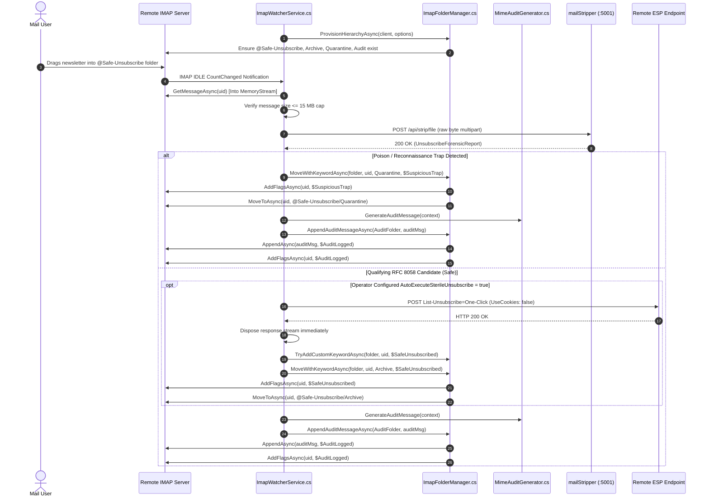
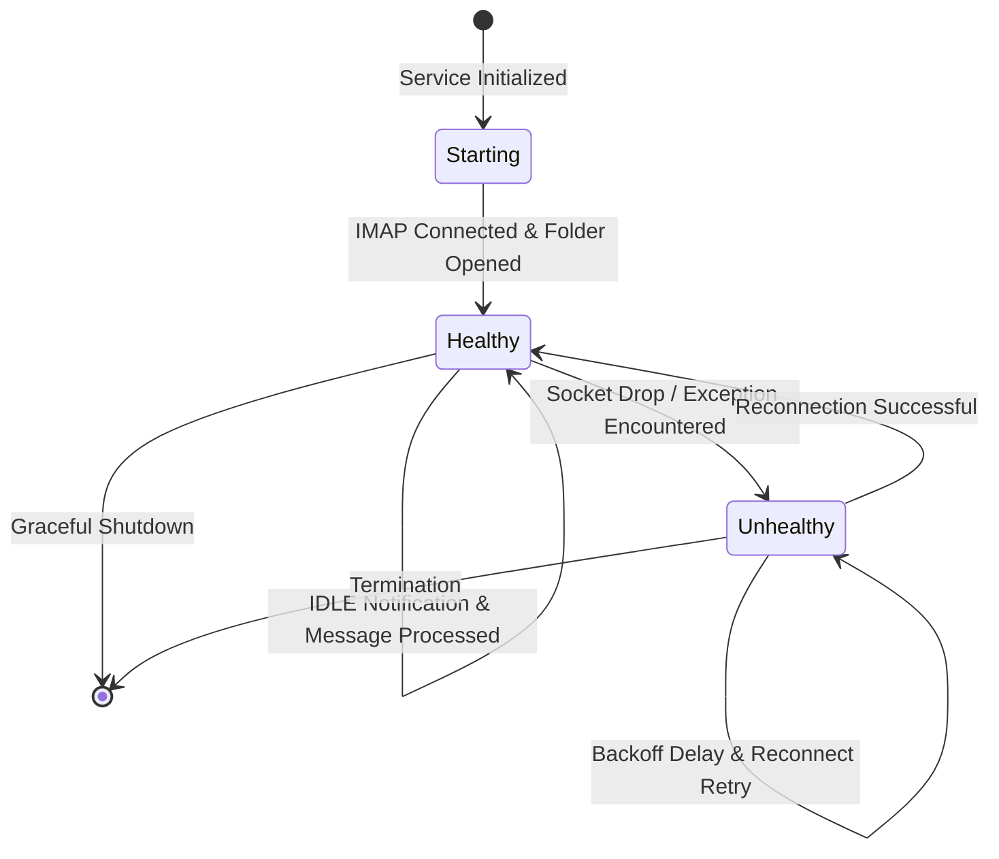

<!-- diagram-meta
  last-validated: 2026-11-10
  validated-commit: 8e64e61
  covers: [MailStripper.Imap/**, MailStripper.Imap.Tests/**, Dockerfile, docker-compose.yml, systemd/**]
  generated-by: manual
-->

# Architecture & Invariants Specification: MailStripper IMAP Watcher

> Protocol-Level IMAP IDLE Quarantine Watcher, Automated Folder Segregator & Sterile Opt-Out Daemon.

---

## 1. Executive Summary

`mail-stripper-imap` is **Companion B** in the `knowthankyew` email privacy suite. Built on Jeffrey Stedfast's [`MailKit`](https://github.com/jstedfast/MailKit) library, it operates as a headless background daemon monitoring a dedicated IMAP mailbox (e.g. `@Safe-Unsubscribe` or `INBOX`) via IMAP IDLE push notifications. Upon receiving a message, it streams raw RFC 822 bytes directly into volatile memory (`MemoryStream`), queries local `mailStripper` (`:5001`) for static forensics, automatically segregates threat traps from valid opt-outs, and can optionally execute automated sterile RFC 8058 One-Click HTTP POST requests under strict operator configuration.

---

## 2. System Architecture & Component Interactions

### A. Execution Topology

```mermaid
flowchart TD
    subgraph RemoteMail["1. Remote Mail Server (IMAP / TLS :993)"]
        IMAPServer["📬 Upstream Mailbox<br/><i>INBOX or @Safe-Unsubscribe</i>"]
        ArchiveBox["📦 @Safe-Unsubscribe/Archive"]
        QuarantineBox["🚨 @Safe-Unsubscribe/Quarantine"]
        AuditBox["📑 @Safe-Unsubscribe/Audit"]
    end

    subgraph DaemonCore["2. .NET 10 IMAP Daemon Core"]
        Watcher["🔄 IMAP IDLE Listener<br/><code>MailStripper.Imap/Services/ImapWatcherService.cs</code>"]
        FolderMgr["📁 Folder & Flag Manager<br/><code>MailStripper.Imap/Services/ImapFolderManager.cs</code>"]
        Backoff["⏱️ Exponential Backoff Policy<br/><code>MailStripper.Imap/Services/ExponentialBackoffPolicy.cs</code>"]
        AuditGen["📑 MIME Audit Generator<br/><code>MailStripper.Imap/Services/MimeAuditGenerator.cs</code>"]
        HealthTracker["🩺 Health State Tracker<br/><code>MailStripper.Imap/Services/ImapHealthTracker.cs</code>"]
        HealthServer["🌐 Health Probe Endpoint (:8080)<br/><code>MailStripper.Imap/Services/HealthEndpointService.cs</code>"]
        MemBuffer["💾 Transient Memory Buffer<br/><i>System.IO.MemoryStream (Zero Disk)</i>"]
        MSClient["📡 mailStripper Client<br/><code>MailStripper.Imap/Services/MailStripperClient.cs</code>"]
        SterileExec["🔒 Sterile RFC 8058 Dispatcher<br/><code>MailStripper.Imap/Services/SterileUnsubscribeDispatcher.cs</code>"]
    end

    subgraph LocalEngine["3. Local Ingestion Plane (:5001)"]
        MailStripper["✉️ mailStripper Ingestion Core<br/><code>http://localhost:5001/api/strip/file</code>"]
    end

    subgraph RemoteTarget["4. Remote ESP Opt-Out Target"]
        ESPEndpoint["🌐 Authenticated HTTPS Target<br/><i>POST List-Unsubscribe=One-Click</i>"]
    end

    subgraph Orchestrator["5. Container / Host Orchestrator"]
        Probes["🔍 Health Probes<br/><i>GET /healthz, /readyz, /livez</i>"]
    end

    IMAPServer -->|"IMAP IDLE Push"| Watcher
    Watcher -->|"Fetch Message Stream"| MemBuffer
    Watcher -.->|"Connection State & Metrics"| HealthTracker
    HealthServer -->|"Query Live State"| HealthTracker
    Probes -->|"HTTP Probes (:8080)"| HealthServer
    MemBuffer -->|"POST raw bytes (multipart)"| MSClient
    MSClient -->|"Stream to :5001"| MailStripper
    MailStripper -->> MSClient: Return Forensic Report
    MSClient -->> Watcher: Parse Report Verdict

    Watcher -->|"If Poison/Trap -> Move"| QuarantineBox
    Watcher -->|"If Valid & Auto-OptOut -> Sterile POST"| SterileExec
    SterileExec -->|"Sterile POST (No Cookies)"| ESPEndpoint
    ESPEndpoint -->> SterileExec: Status Only
    Watcher -->|"Move Processed Message"| ArchiveBox
    Watcher -->|"Emit Audit Report MIME"| AuditBox

    classDef remote fill:#0f172a,stroke:#64748b,stroke-width:1px,color:#f8fafc;
    classDef core fill:#1e293b,stroke:#38bdf8,stroke-width:2px,color:#f8fafc;
    classDef local fill:#14532d,stroke:#22c55e,stroke-width:2px,color:#f8fafc;
    classDef esp fill:#78350f,stroke:#f59e0b,stroke-width:2px,color:#f8fafc;
    classDef orch fill:#312e81,stroke:#818cf8,stroke-width:1px,color:#f8fafc;

    class IMAPServer,ArchiveBox,QuarantineBox,AuditBox remote;
    class Watcher,FolderMgr,Backoff,AuditGen,HealthTracker,HealthServer,MemBuffer,MSClient,SterileExec core;
    class MailStripper local;
    class ESPEndpoint esp;
    class Probes orch;
```

### B. Message Ingestion & Quarantine Sequence



> **Operator Dry-Run Mode**: When `AutoExecuteSterileUnsubscribe` is `false` (the default setting), valid candidates remain in `@Safe-Unsubscribe` for manual operator review without executing HTTP requests or moving to Archive.

### C. Health Probing & Lifecycle State Model



---

## 3. Core Architectural Invariants

| # | Invariant | Enforcement & Guarantee |
|:--|:----------|:------------------------|
| 1 | **100% Volatile RAM Ingestion** | All message parsing and streaming resides exclusively in `MemoryStream`. Zero bytes are ever written to disk or `/tmp`. |
| 2 | **Central Package Management (CPM)** | 100% of NuGet dependencies pinned in `Directory.Packages.props` with MSBuild fail-closed audit (`NU1901-NU1904`). |
| 3 | **Sterile RFC 8058 HTTP Execution** | Enforces `UseCookies = false`, `AllowAutoRedirect = false`, `https://` only, and immediate response body disposal. |
| 4 | **Size Budgeting** | Bounded at 15 MB per message to prevent heap exhaustion during batch sweeps. |
| 5 | **Strict Isolation** | Operates strictly on designated IMAP quarantine folders without modifying user's primary inbox without configuration. |
| 6 | **Unprivileged Sandbox Execution** | Container executes under non-root unprivileged credentials (`USER $APP_UID`), and systemd unit drops capabilities with strict filesystem sandboxing (`ProtectSystem=strict`, `NoNewPrivileges=true`, `PrivateTmp=true`). |
